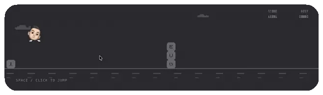

<picture><source media="(max-width: 600px) and (prefers-color-scheme:dark)" srcset="assets/profile/hero-sm-dark.svg"><source media="(prefers-color-scheme: dark)" srcset="assets/profile/hero-dark.svg"><source media="(max-width: 600px) and (prefers-color-scheme:light)" srcset="assets/profile/hero-sm-light.svg"></picture>

<p align="center"><a href="https://miguelclavel.com/?utm_source=github&utm_medium=profile"><picture><source media="(prefers-color-scheme: dark)" srcset="assets/profile/btn-portfolio-dark.webp"></picture></a><a href="https://chat.miguelclavel.com/?utm_source=github&utm_medium=profile"><picture><source media="(prefers-color-scheme: dark)" srcset="assets/profile/btn-chat-dark.webp"></picture></a></p>

<p align="center"><a href="https://www.linkedin.com/in/miguelclavel/">LinkedIn</a> &nbsp;·&nbsp; <a href="https://miguelclavel.com/assets/Miguel-Clavel-Senior-Product-Designer-Resume-2026.pdf">Resume (PDF)</a> &nbsp;·&nbsp; <a href="https://miguelclavel.github.io/">Live demos</a> &nbsp;·&nbsp; <a href="mailto:hello@miguelclavel.com">hello@miguelclavel.com</a></p>

<picture><source media="(max-width: 600px) and (prefers-color-scheme:dark)" srcset="assets/profile/stats-sm-dark.svg"><source media="(prefers-color-scheme: dark)" srcset="assets/profile/stats-dark.svg"><source media="(max-width: 600px) and (prefers-color-scheme:light)" srcset="assets/profile/stats-sm-light.svg"></picture>

<picture><source media="(max-width: 600px) and (prefers-color-scheme:dark)" srcset="assets/profile/h-work-sm-dark.svg"><source media="(prefers-color-scheme: dark)" srcset="assets/profile/h-work-dark.svg"><source media="(max-width: 600px) and (prefers-color-scheme:light)" srcset="assets/profile/h-work-sm-light.svg"></picture>

<p align="center"><a href="https://miguelclavel.com/work/auto-insurance-conversational-flow?utm_source=github&utm_medium=profile"><picture><source media="(max-width: 600px) and (prefers-color-scheme:dark)" srcset="assets/profile/work-1-sm-dark.svg"><source media="(prefers-color-scheme: dark)" srcset="assets/profile/work-1-dark.svg"><source media="(max-width: 600px) and (prefers-color-scheme:light)" srcset="assets/profile/work-1-sm-light.svg"></picture></a><a href="https://miguelclavel.com/work/insurance-landing-page?utm_source=github&utm_medium=profile"><picture><source media="(max-width: 600px) and (prefers-color-scheme:dark)" srcset="assets/profile/work-2-sm-dark.svg"><source media="(prefers-color-scheme: dark)" srcset="assets/profile/work-2-dark.svg"><source media="(max-width: 600px) and (prefers-color-scheme:light)" srcset="assets/profile/work-2-sm-light.svg"></picture></a><a href="https://miguelclavel.com/work/360-homepage-redesign?utm_source=github&utm_medium=profile"><picture><source media="(max-width: 600px) and (prefers-color-scheme:dark)" srcset="assets/profile/work-3-sm-dark.svg"><source media="(prefers-color-scheme: dark)" srcset="assets/profile/work-3-dark.svg"><source media="(max-width: 600px) and (prefers-color-scheme:light)" srcset="assets/profile/work-3-sm-light.svg"></picture></a><a href="https://miguelclavel.com/work/comparison-system?utm_source=github&utm_medium=profile"><picture><source media="(max-width: 600px) and (prefers-color-scheme:dark)" srcset="assets/profile/work-4-sm-dark.svg"><source media="(prefers-color-scheme: dark)" srcset="assets/profile/work-4-dark.svg"><source media="(max-width: 600px) and (prefers-color-scheme:light)" srcset="assets/profile/work-4-sm-light.svg"></picture></a><a href="https://miguelclavel.com/work/us-news-brand-guide?utm_source=github&utm_medium=profile"><picture><source media="(max-width: 600px) and (prefers-color-scheme:dark)" srcset="assets/profile/work-5-sm-dark.svg"><source media="(prefers-color-scheme: dark)" srcset="assets/profile/work-5-dark.svg"><source media="(max-width: 600px) and (prefers-color-scheme:light)" srcset="assets/profile/work-5-sm-light.svg"></picture></a><a href="https://miguelclavel.com/work/miami-heat-homepage?utm_source=github&utm_medium=profile"><picture><source media="(max-width: 600px) and (prefers-color-scheme:dark)" srcset="assets/profile/work-6-sm-dark.svg"><source media="(prefers-color-scheme: dark)" srcset="assets/profile/work-6-dark.svg"><source media="(max-width: 600px) and (prefers-color-scheme:light)" srcset="assets/profile/work-6-sm-light.svg"></picture></a></p>

<details>
<summary><b>Six more case studies</b></summary>

- [Mindset Landing Page Strategy](https://miguelclavel.com/work/mindset-landing-page-strategy?utm_source=github&utm_medium=profile): three testable landing page directions and an experiment plan.
- [Monthly Testing Review](https://miguelclavel.com/work/monthly-testing-review?utm_source=github&utm_medium=profile): experiment operations that turned isolated A/B tests into shared learning.
- [Arena Rebrand and CMS Migration](https://miguelclavel.com/work/arena-rebrand-cms?utm_source=github&utm_medium=profile): a live arena site kept accurate through a full rebrand and CMS migration.
- [BLU Products Launch System](https://miguelclavel.com/work/blu-products-launch-system?utm_source=github&utm_medium=profile): more than 20 phone launches, every channel running off one set of parts.
- [601 Miami Website](https://miguelclavel.com/work/601-miami-website?utm_source=github&utm_medium=profile): hospitality UX for a restaurant and private events venue.
- [Medical Training Membership Journey](https://miguelclavel.com/work/medical-training-membership-journey?utm_source=github&utm_medium=profile): a training catalog turned into a clear membership decision.

</details>

<picture><source media="(max-width: 600px) and (prefers-color-scheme:dark)" srcset="assets/profile/h-built-sm-dark.svg"><source media="(prefers-color-scheme: dark)" srcset="assets/profile/h-built-dark.svg"><source media="(max-width: 600px) and (prefers-color-scheme:light)" srcset="assets/profile/h-built-sm-light.svg"></picture>

<p align="center"><a href="https://chat.miguelclavel.com/?utm_source=github&utm_medium=profile"><picture><source media="(max-width: 600px) and (prefers-color-scheme:dark)" srcset="assets/profile/built-chat-sm-dark.svg"><source media="(prefers-color-scheme: dark)" srcset="assets/profile/built-chat-dark.svg"><source media="(max-width: 600px) and (prefers-color-scheme:light)" srcset="assets/profile/built-chat-sm-light.svg"></picture></a><a href="https://miguelclavel.com/?utm_source=github&utm_medium=profile"><picture><source media="(max-width: 600px) and (prefers-color-scheme:dark)" srcset="assets/profile/built-site-sm-dark.svg"><source media="(prefers-color-scheme: dark)" srcset="assets/profile/built-site-dark.svg"><source media="(max-width: 600px) and (prefers-color-scheme:light)" srcset="assets/profile/built-site-sm-light.svg"></picture></a></p>

How they were built: [chat-portfolio](https://github.com/miguelclavel/chat-portfolio) and its [build log](https://github.com/miguelclavel/chat-portfolio/blob/main/BUILD-LOG.md) · [what broke at launch on miguelclavel.com](https://github.com/miguelclavel/miguelclavel.com)

<picture><source media="(max-width: 600px) and (prefers-color-scheme:dark)" srcset="assets/profile/h-ai-sm-dark.svg"><source media="(prefers-color-scheme: dark)" srcset="assets/profile/h-ai-dark.svg"><source media="(max-width: 600px) and (prefers-color-scheme:light)" srcset="assets/profile/h-ai-sm-light.svg"></picture>

<p align="center"><a href="https://github.com/miguelclavel/ai-ux-patterns"><picture><source media="(max-width: 600px) and (prefers-color-scheme:dark)" srcset="assets/profile/kit-1-sm-dark.svg"><source media="(prefers-color-scheme: dark)" srcset="assets/profile/kit-1-dark.svg"><source media="(max-width: 600px) and (prefers-color-scheme:light)" srcset="assets/profile/kit-1-sm-light.svg"></picture></a><a href="https://github.com/miguelclavel/claude-skills-for-designers"><picture><source media="(max-width: 600px) and (prefers-color-scheme:dark)" srcset="assets/profile/kit-2-sm-dark.svg"><source media="(prefers-color-scheme: dark)" srcset="assets/profile/kit-2-dark.svg"><source media="(max-width: 600px) and (prefers-color-scheme:light)" srcset="assets/profile/kit-2-sm-light.svg"></picture></a><a href="https://github.com/miguelclavel/ux-research-skills"><picture><source media="(max-width: 600px) and (prefers-color-scheme:dark)" srcset="assets/profile/kit-3-sm-dark.svg"><source media="(prefers-color-scheme: dark)" srcset="assets/profile/kit-3-dark.svg"><source media="(max-width: 600px) and (prefers-color-scheme:light)" srcset="assets/profile/kit-3-sm-light.svg"></picture></a><a href="https://github.com/miguelclavel/ai-prompts-for-designers"><picture><source media="(max-width: 600px) and (prefers-color-scheme:dark)" srcset="assets/profile/kit-4-sm-dark.svg"><source media="(prefers-color-scheme: dark)" srcset="assets/profile/kit-4-dark.svg"><source media="(max-width: 600px) and (prefers-color-scheme:light)" srcset="assets/profile/kit-4-sm-light.svg"></picture></a><a href="https://github.com/miguelclavel/product-design-playbook"><picture><source media="(max-width: 600px) and (prefers-color-scheme:dark)" srcset="assets/profile/kit-5-sm-dark.svg"><source media="(prefers-color-scheme: dark)" srcset="assets/profile/kit-5-dark.svg"><source media="(max-width: 600px) and (prefers-color-scheme:light)" srcset="assets/profile/kit-5-sm-light.svg"></picture></a><a href="https://github.com/miguelclavel/portfolio-chat-starter"><picture><source media="(max-width: 600px) and (prefers-color-scheme:dark)" srcset="assets/profile/kit-6-sm-dark.svg"><source media="(prefers-color-scheme: dark)" srcset="assets/profile/kit-6-dark.svg"><source media="(max-width: 600px) and (prefers-color-scheme:light)" srcset="assets/profile/kit-6-sm-light.svg"></picture></a></p>

[Find any of my 28 skills by job](https://github.com/miguelclavel/claude-skills-for-designers/blob/main/SKILLS.md). They install in Claude Code in two commands; the research set is `ux-research-skills@miguelclavel`.

```
/plugin marketplace add miguelclavel/claude-skills-for-designers
/plugin install claude-skills-for-designers@miguelclavel
```

<picture><source media="(max-width: 600px) and (prefers-color-scheme:dark)" srcset="assets/profile/h-copy-sm-dark.svg"><source media="(prefers-color-scheme: dark)" srcset="assets/profile/h-copy-dark.svg"><source media="(max-width: 600px) and (prefers-color-scheme:light)" srcset="assets/profile/h-copy-sm-light.svg"></picture>

<p align="center"><a href="https://github.com/miguelclavel/interaction-recipes"><picture><source media="(max-width: 600px)" srcset="assets/profile/demo-pixel-trail-sm.webp"></picture></a><a href="https://miguelclavel.github.io/pixel-run-game/"><picture><source media="(max-width: 600px)" srcset="assets/profile/demo-pixel-run-sm.webp"></picture></a></p>

**[Interaction recipes](https://github.com/miguelclavel/interaction-recipes)**: twenty small interactions and fixes from my two portfolios, each with a recording, what went wrong, and the prompt to build your own. **[Pixel Run](https://miguelclavel.github.io/pixel-run-game/)**: the game in my footer, where the blocks you jump spell my name.

<sub>One repo and live page each: [name-hover](https://github.com/miguelclavel/name-hover) · [pixel-trail](https://github.com/miguelclavel/pixel-trail) · [wave-line](https://github.com/miguelclavel/wave-line) · [scroll-into-header](https://github.com/miguelclavel/scroll-into-header) · [pixel-dissolve](https://github.com/miguelclavel/pixel-dissolve) · [dark-mode](https://github.com/miguelclavel/dark-mode) · [sticker-burst](https://github.com/miguelclavel/sticker-burst) · [curve-carousel](https://github.com/miguelclavel/curve-carousel) · [portfolio-details](https://github.com/miguelclavel/portfolio-details) · [pixel-run-game](https://github.com/miguelclavel/pixel-run-game)</sub>

<picture><source media="(max-width: 600px) and (prefers-color-scheme:dark)" srcset="assets/profile/how-sm-dark.svg"><source media="(prefers-color-scheme: dark)" srcset="assets/profile/how-dark.svg"><source media="(max-width: 600px) and (prefers-color-scheme:light)" srcset="assets/profile/how-sm-light.svg"></picture>

<picture><source media="(max-width: 600px) and (prefers-color-scheme:dark)" srcset="assets/profile/h-exp-sm-dark.svg"><source media="(prefers-color-scheme: dark)" srcset="assets/profile/h-exp-dark.svg"><source media="(max-width: 600px) and (prefers-color-scheme:light)" srcset="assets/profile/h-exp-sm-light.svg"></picture>

<picture><source media="(max-width: 600px) and (prefers-color-scheme:dark)" srcset="assets/profile/exp-sm-dark.svg"><source media="(prefers-color-scheme: dark)" srcset="assets/profile/exp-dark.svg"><source media="(max-width: 600px) and (prefers-color-scheme:light)" srcset="assets/profile/exp-sm-light.svg"></picture>

<picture><source media="(max-width: 600px) and (prefers-color-scheme:dark)" srcset="assets/profile/tools-sm-dark.svg"><source media="(prefers-color-scheme: dark)" srcset="assets/profile/tools-dark.svg"><source media="(max-width: 600px) and (prefers-color-scheme:light)" srcset="assets/profile/tools-sm-light.svg"></picture>

---

<sub>More in the <a href="https://github.com/miguelclavel/miguelclavel/wiki">wiki</a>: every case study, how I work with AI, and the interaction prompts. Work is shown for portfolio purposes and was produced during my employment with the companies named. Confidential material has been omitted or altered.</sub>
